# Add a game

Add a game the catalog doesn't know, such as your own copy of a CD game, and set it up yourself: put its disc with it, name it, choose what goes in its drives, and play. Everything here is done from KairoDos's own screens, and all of it is kept.

## 1. Add the game and its disc

Copy the game (a ZIP or a folder) into your DOS folder, with its disc or disk images beside it at the top of the folder: an ISO, or a CUE sheet with its BIN, for a CD; IMG or IMA for a floppy. Then open the library menu › **Refresh**. A game the catalog doesn't know is listed under its file name, and so is its disc.

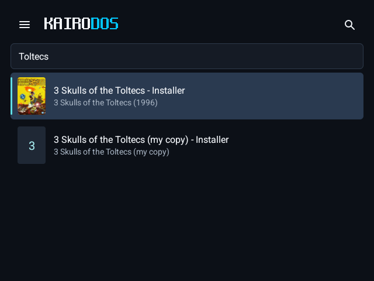

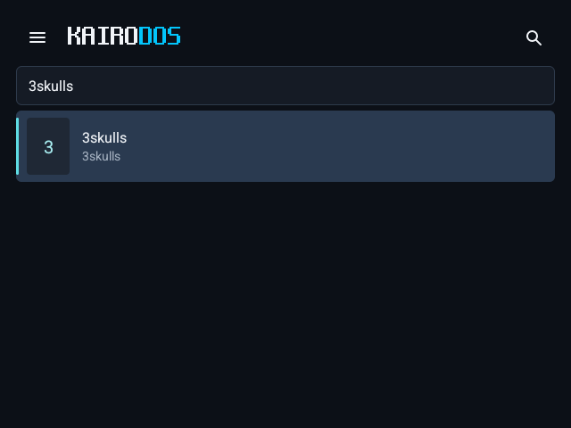

## 2. Put its disc with it

Open the game › **Game settings** (on a two-screen device, Game settings is on the second screen). Under **Library**, **Disks** lists the disk and disc images beside the game.

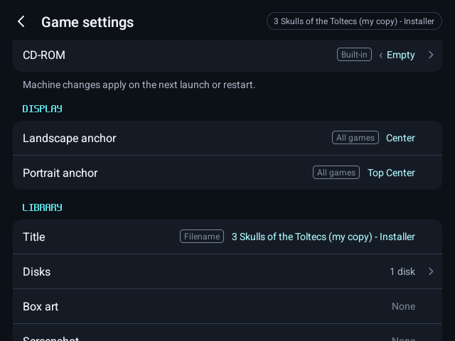

Switch on the game's disc. It leaves the library list and becomes this game's; the row reads "2 disks".

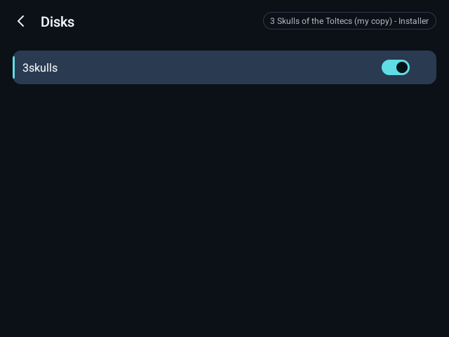

## 3. Name it

Under **Library**, **Title**: type the game's name and save. **Box art** and **Screenshot** take images from your device.

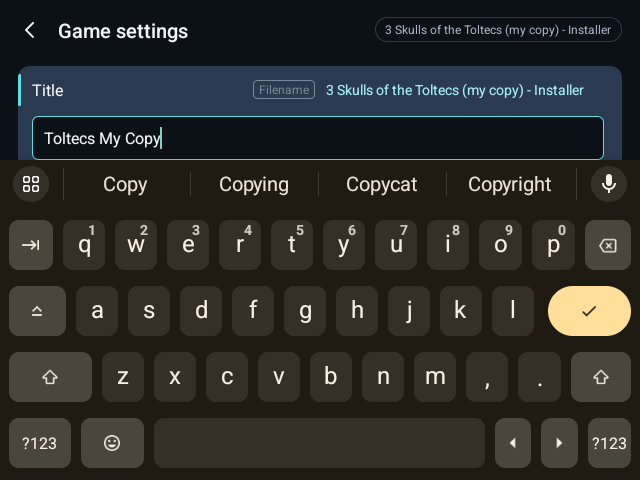

The library now lists it once, under its name.

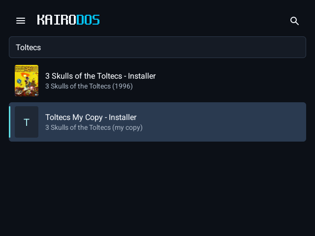

## 4. Choose its drives

Under **Machine**, **Drive A**, **Drive B** and **CD-ROM** choose the images the game starts with: floppy images for the drives, a CD image for the CD-ROM (D:). Here the CD-ROM holds the game's disc.

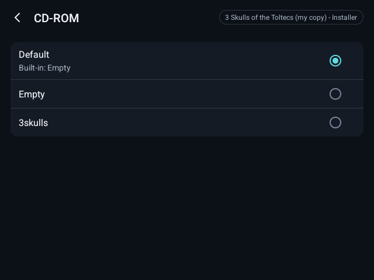

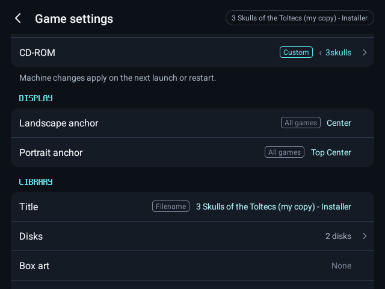

## 5. Firmware

None: DOS games need no firmware.

## 6. Configure

Everything else in Game settings (controls, CPU speed, video card, joystick, the DOS version and startup commands, display) is kept for this game alone.

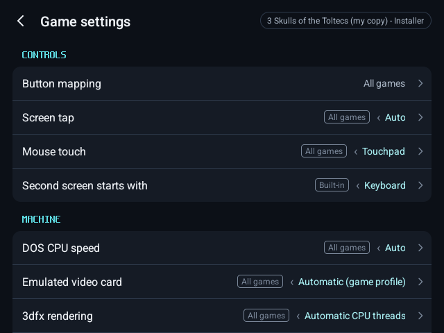

## 7. Play

Press **Play**. The game's files are on C: and its disc in D:; start the game from C: (here `3skulls`), or let its startup commands do it.

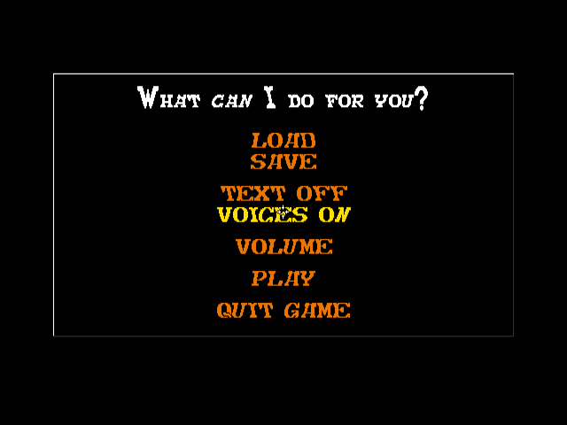

In the menu, **Disks** shows each drive.

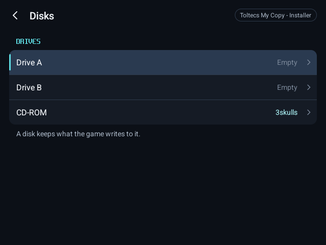

Each drive lists the game's images first, under **This game**, for swapping when it asks; **Choose file…** and **Choose folder…** take one from anywhere on the device.

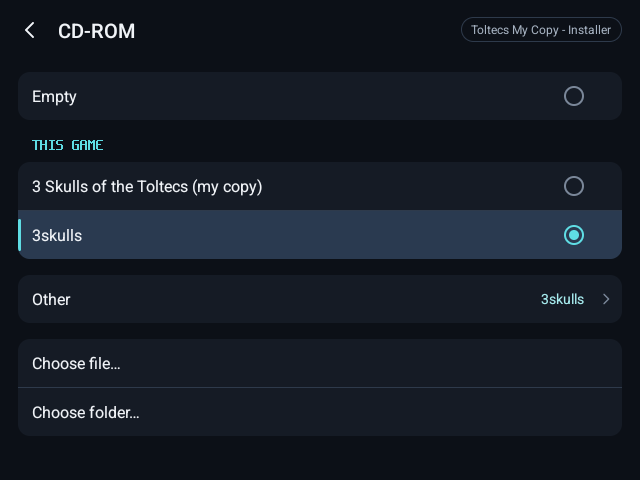

## 8. It is kept

What the game writes (its saves, its settings files) is kept for it, as for every KairoDos game. After closing and reopening KairoDos, the game is still one game with its name, disc and settings.

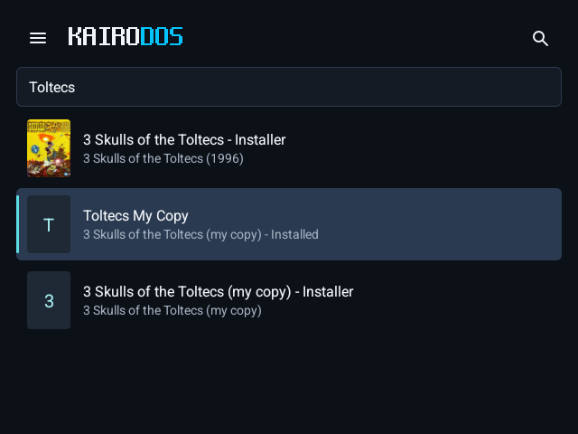

It starts with its disc in D: again.

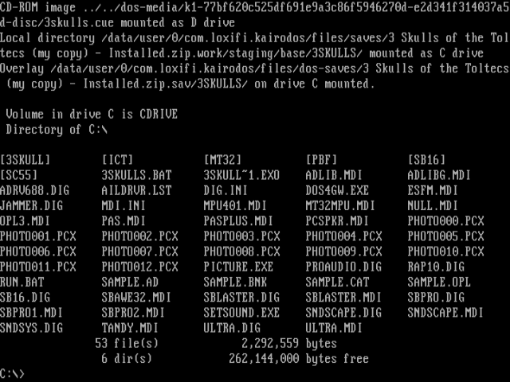

An eXoDOS-style game is installed into an archive of its own the first time it plays; its name, disc and settings go with it.
