# Create a game

Install a DOS game from its own installer disks onto a new, empty C: drive. The installer's floppy images, CD image or folder can stay wherever they are (for example in Download): the Disks page mounts them from anywhere on the device. Nothing is written to your games folder until the new drive holds a file; then it is saved there as `<name>.zip`, a game like any other.

## 1. Start a new game on an empty C: drive

Open the library menu › **Manage library**. Under **New game**, choose **Empty C: drive**.

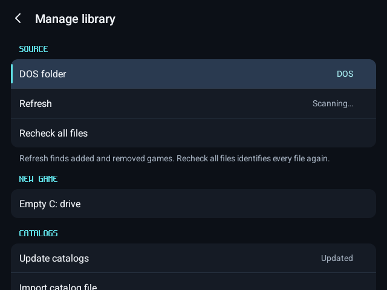

Name the game and press **Create**.

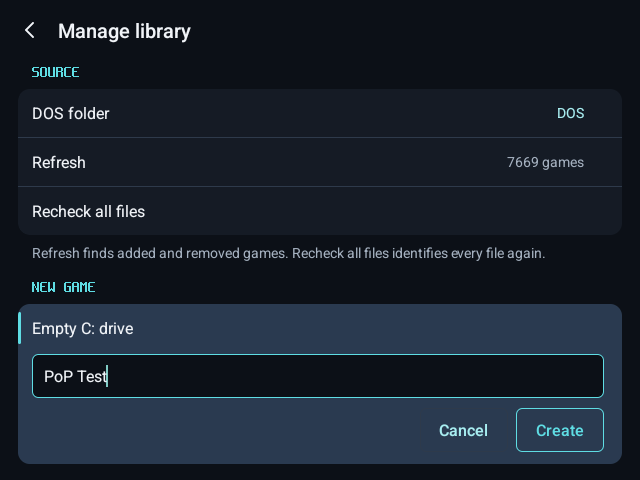

The game starts at the DOS prompt on an empty C:.

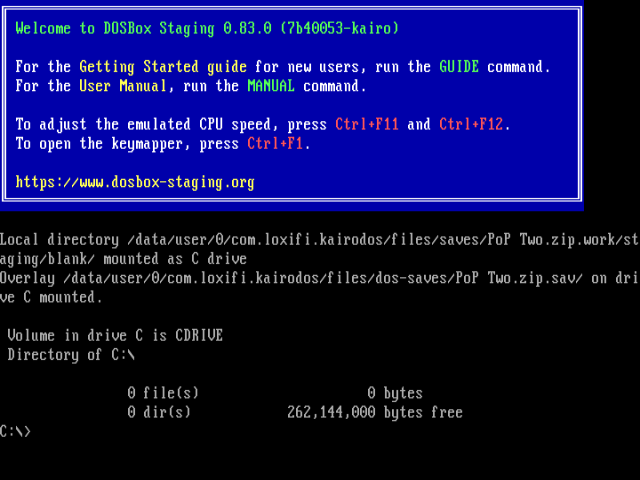

## 2. Mount the installer

Open the menu › **Disks**. Drive A and Drive B take floppy images (.img, .ima), the CD-ROM takes a CD image (.iso); each also takes a folder or a zip.

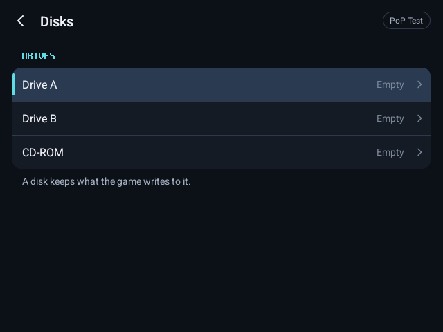

Choose the drive, then **Choose file…** for an image or **Choose folder…** for a folder.

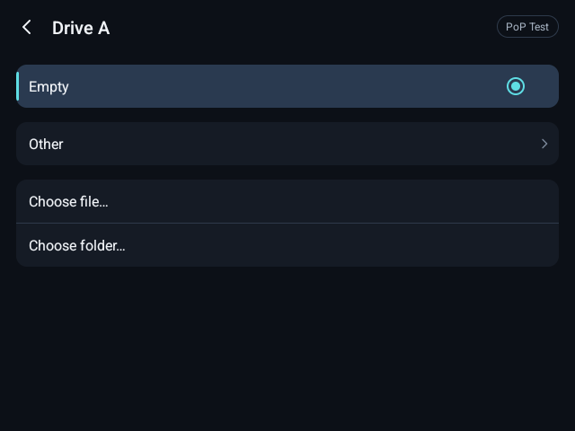

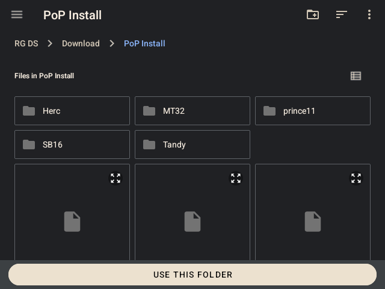

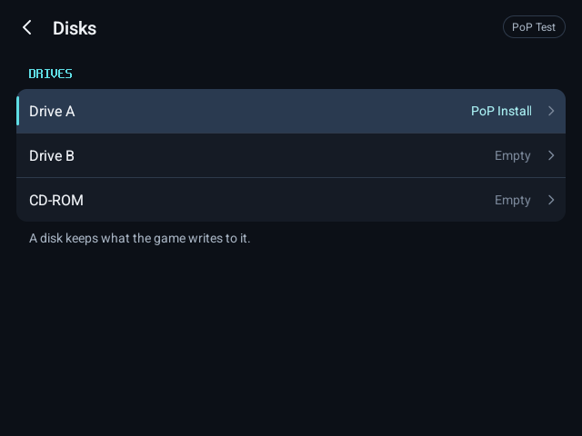

`dir a:` lists the installer's files.

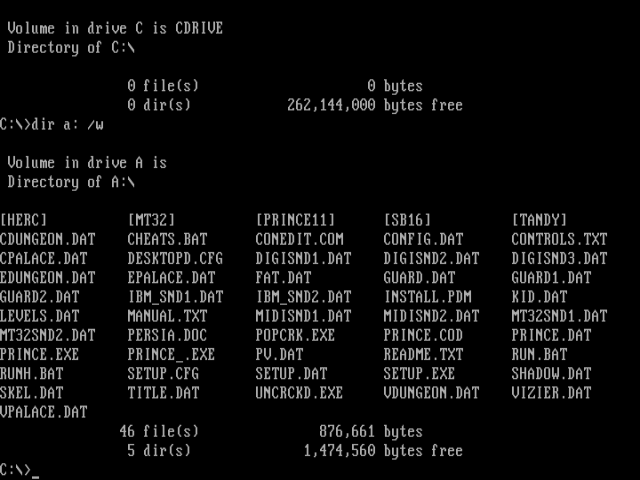

## 3. Install

Run the game's installer and install to C:, or copy the files yourself. Here: `md persia`, `xcopy a:\*.* c:\persia /s`.

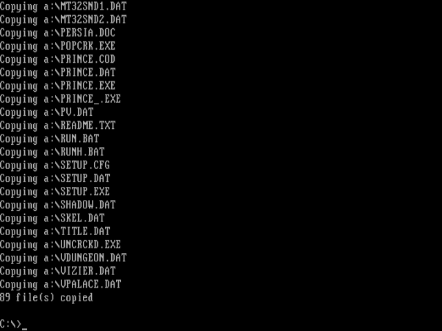

Start the game from C: to try it. Restart game keeps the Disks drives as they are.

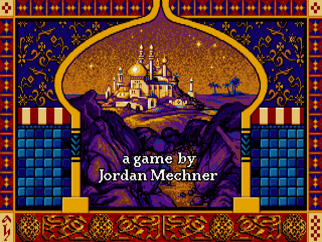

## 4. Save it to your library

Leave the game (Return to library or Exit). KairoDos saves the new drive to your games folder as `<name>.zip`; it appears in the library and plays like any other game. If the catalog knows the installed game, it gets the game's title, artwork and setup.

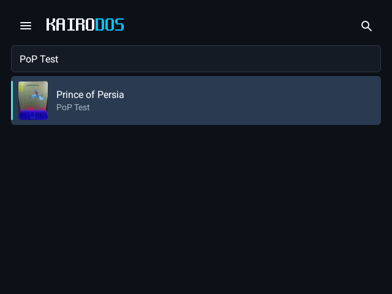

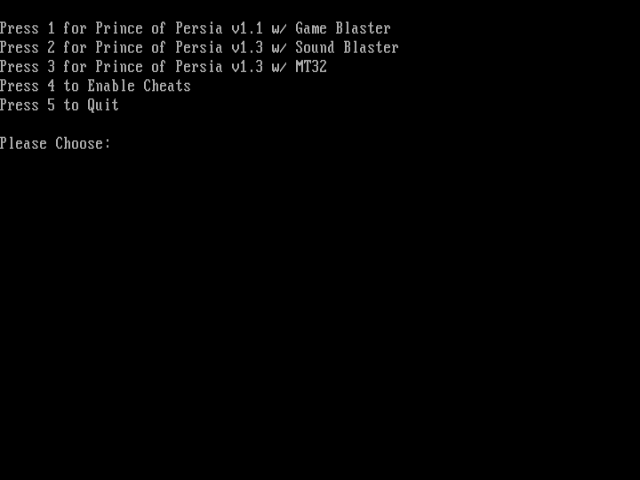

A new game left empty leaves nothing behind. If the app is stopped before the session ends, the new game is saved the next time KairoDos opens. From then on, what the game writes is kept in its saves, as for every KairoDos game.
